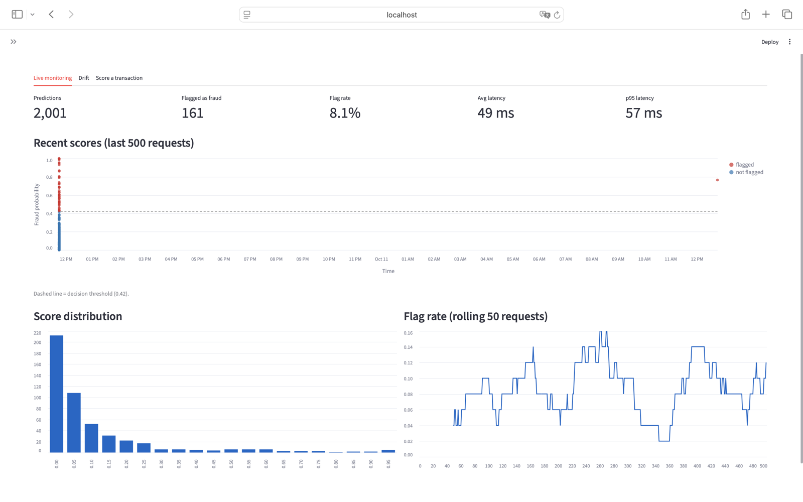
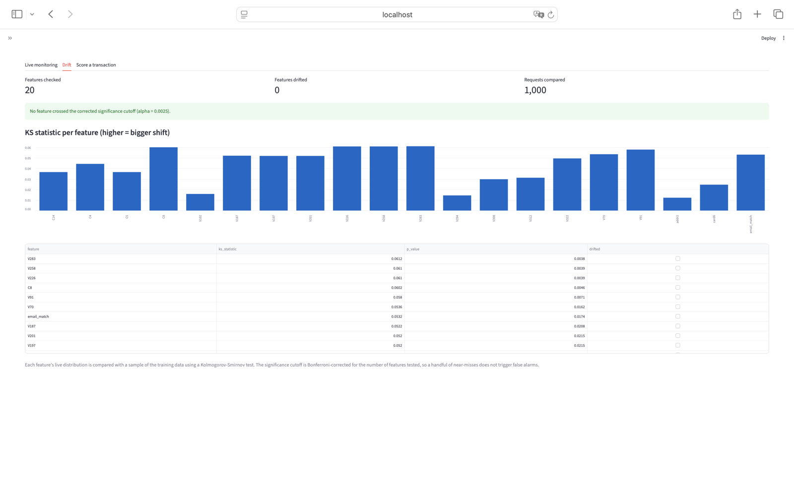
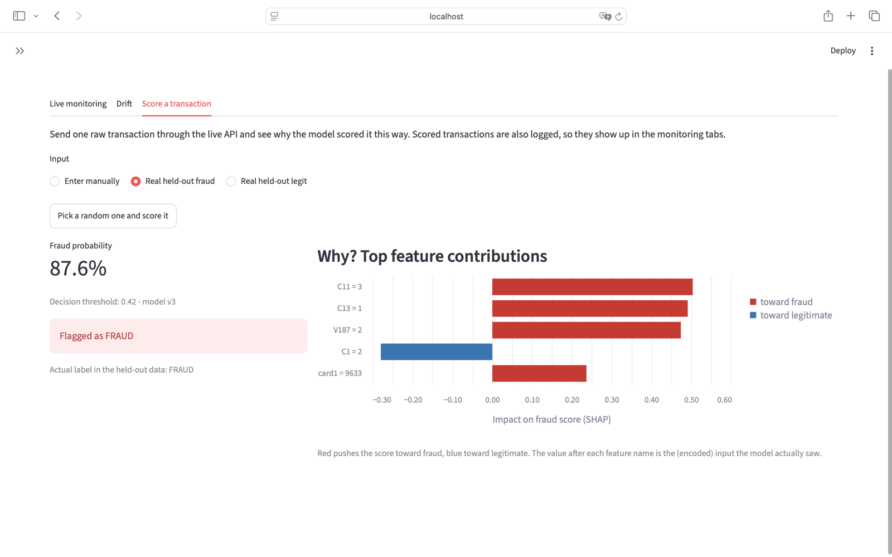

# Explainable Fraud Detection System


An end-to-end fraud detection system on the IEEE-CIS dataset (590,540 card transactions, 3.5% fraud): an XGBoost model with SHAP explanations, served through an authenticated FastAPI service, containerised with Docker Compose, tested and built in CI, and watched by a Streamlit dashboard with statistical drift monitoring.

The project focuses on doing the evaluation honestly: chronological splits, no leakage, decisions made on validation data, and an operating point chosen from an explicit cost trade-off.



## Results

Held-out test window: the most recent 20% of transactions by time (118,108 transactions, 4,064 frauds). Nothing was fitted on it.

| Metric | Value |
|---|---|
| ROC-AUC | 0.9006 |
| PR-AUC | 0.511 |
| Fraud caught at 1% false-alarm rate | 42.7% |
| Fraud caught at 5% false-alarm rate | 61.7% |

The catch rate depends on how many false alarms you accept. The threshold for each row was chosen on validation data by minimising `miss_cost x missed frauds + false alarms`, then applied once to the test window:

| One missed fraud costs | Threshold | Frauds caught | False alarms | Recall | Precision |
|---|---|---|---|---|---|
| 1 false alarm | 0.81 | 1,563 | 694 | 38.5% | 69.3% |
| 5 | 0.57 | 2,198 | 3,232 | 54.1% | 40.5% |
| **10 (default)** | **0.42** | 2,578 | 6,521 | 63.4% | 28.3% |
| 20 | 0.31 | 2,924 | 10,904 | 71.9% | 21.1% |

The default can be changed without rebuilding: `DECISION_THRESHOLD=0.57` as an environment variable.

Serving latency including the full feature pipeline and a SHAP explanation: about 49 ms average, 56 ms p95 per request (local Docker, single worker).

## Architecture

```
raw transaction --> FeaturePipeline --> XGBoost --> score + SHAP explanation
                    (fitted on train          |
                     data only)               v
                              FastAPI: /predict  /predict/batch  /stats  /drift
                                   |                      ^
                          logs/ (features, scores)        |
                                   |                      |
                    KS drift test vs training sample --> Streamlit dashboard
```

- **One feature pipeline for training and serving.** The API accepts raw transaction fields; the same saved `FeaturePipeline` that trained the model builds the features at request time. Tests check that engineered features are computed server-side, that unseen categories do not crash, and that a row scored alone gets the same features as inside a batch.
- **Explainable by default.** Every prediction returns the top SHAP feature contributions.
- **Drift monitoring.** Logged requests are compared with a sample of the training data using Kolmogorov-Smirnov tests on the model's 20 most important features, with a Bonferroni-corrected threshold.

| | |
|---|---|
|  |  |

## Methodology decisions

- **Chronological split (72% train / 8% validation / 20% test), not random.** A random split with aggregates computed on all data scored ROC-AUC 0.927; fixing the leakage and splitting by time gave 0.903 with the same default settings. The lower number is the honest one.
- **Leakage-safe features.** Card-level frequency and average-amount features are learned from training rows only; unseen cards fall back to a median.
- **Decisions on validation, not test.** The feature set and the threshold are chosen on the validation slice. The test window is scored once at the end.
- **A rejected experiment.** Customer-level aggregate features (a pseudo customer id built from card, address and account age) did not beat the simpler feature set on validation (PR-AUC 0.597 vs 0.603), so they were dropped.

## Limitations

- The model hyperparameters come from an earlier search whose candidates were scored on the test window, so the test numbers may be slightly optimistic. Re-tuning on validation data only is on the roadmap.
- Performance is lower on the test window than on validation (PR-AUC 0.51 vs 0.60), which is consistent with the model decaying on newer data. This is why drift monitoring and periodic retraining matter.
- The dataset is anonymised and from 2019; the V1-V339 features cannot be interpreted.
- The default operating point (one missed fraud = 10 false alarms) is an assumption. The right value depends on the cost of fraud versus manual review.
- Authentication is a single API key, suitable for a demo, not for production.

## Run it

```bash
echo "API_KEY=choose-a-secret" > .env
docker compose up --build -d
```

- Dashboard: http://localhost:8501
- API docs: http://localhost:8000/docs

Example request (any other raw dataset column can be added to the body; missing fields are treated as missing values, so fewer fields means a less informed score):

```bash
curl -X POST http://localhost:8000/predict \
  -H "x-api-key: $API_KEY" -H "Content-Type: application/json" \
  -d '{"TransactionAmt": 150.0, "TransactionDT": 12960000, "ProductCD": "W", "card1": 13926, "card4": "visa", "card6": "credit", "P_emaildomain": "gmail.com"}'
```

The trained model, pipeline and metrics are committed under `models/`, so the API runs without retraining. The dashboard's "real held-out transaction" buttons need `data/processed/raw_test_sample.csv`, which training creates.

## Retrain

Download the IEEE-CIS Fraud Detection data from Kaggle into `data/raw/` (`train_transaction.csv`, `train_identity.csv`), then:

```bash
python -m src.train --features compare            # compare feature sets on validation
python -m src.train --features base --tune 20     # tune hyperparameters on validation
python -m src.train --features base --miss-cost 5 # choose a different operating point
```

Other useful commands:

```bash
pytest tests/ -q                                         # API and skew tests
python scripts/simulate_traffic.py --n 2000 --api-key $API_KEY   # replay held-out raw transactions
PYTHONPATH=. python scripts/check_parity.py              # score the same rows offline for comparison
```

CI (GitHub Actions) runs the tests, builds the Docker image and smoke-tests the container on every push.

## Roadmap

- Re-tune hyperparameters on validation data only
- Per-card velocity features (transactions in the last hour or day) backed by a feature store
- Amount-aware cost model for the threshold
- Live deployment and scheduled retraining
